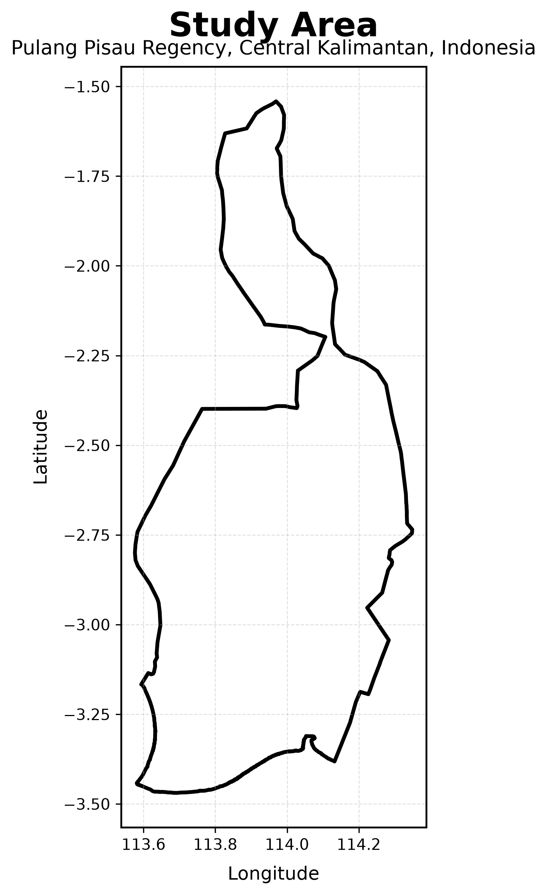
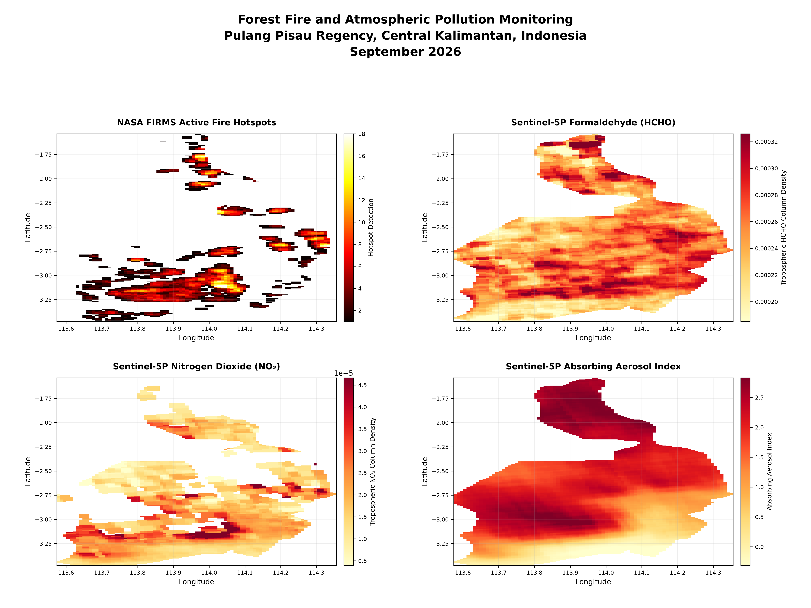
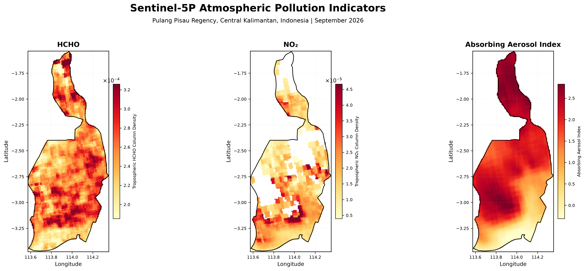

# Pulang Pisau Wildfire and Atmospheric Pollution Analysis

## Remote Sensing-Based Forest Fire and Atmospheric Pollution Analysis

This repository presents a remote sensing-based geospatial analysis workflow for assessing forest-fire activity and atmospheric pollution indicators in Pulang Pisau Regency, Central Kalimantan, Indonesia.

The project integrates satellite-derived fire detection data from NASA FIRMS with Sentinel-5P atmospheric composition products to examine the spatial distribution of wildfire activity and selected atmospheric pollution indicators.

The workflow includes spatial data processing, study-area mapping, monthly fire-activity analysis, atmospheric pollution visualization, and map generation using Python and geospatial datasets.

---

## Study Area

The study focuses on **Pulang Pisau Regency, Central Kalimantan, Indonesia**.

The study area is represented by a GeoJSON boundary that serves as the spatial reference for processing, analysis, and visualization of the satellite-derived datasets.

---

## Data Sources

### NASA FIRMS Fire Detection

NASA FIRMS fire-detection data are used to examine the spatial and temporal distribution of active fire detections within the study area.

The analysis covers:

- July 2026
- August 2026
- September 2026

The monthly datasets support the assessment of changes in wildfire activity across the study period.

### Sentinel-5P Atmospheric Indicators

Sentinel-5P satellite products are used to characterize selected atmospheric pollution indicators over Pulang Pisau Regency.

The analyzed atmospheric indicators include:

- Tropospheric Formaldehyde (HCHO)
- Tropospheric Nitrogen Dioxide (NO₂)
- Absorbing Aerosol Index (AAI)

These indicators are visualized spatially to support the assessment of atmospheric conditions associated with wildfire activity.

---

## Tools and Technologies

- Google Earth Engine
- NASA FIRMS
- Sentinel-5P
- Python
- GeoPandas
- Rasterio
- Matplotlib
- NumPy
- GeoJSON
- Git and GitHub

---

## Methodology

The project follows a structured geospatial workflow:

1. Define the Pulang Pisau study area using a GeoJSON boundary.
2. Process monthly NASA FIRMS fire-detection datasets.
3. Analyze the spatial distribution of active fire detections.
4. Process Sentinel-5P atmospheric composition datasets.
5. Extract and visualize HCHO, NO₂, and Absorbing Aerosol Index indicators.
6. Generate thematic maps and analytical figures.
7. Organize processed datasets, scripts, and visualization outputs for reproducible analysis.

---

## Key Outputs

The project produces several spatial and analytical outputs, including:

- Study-area map of Pulang Pisau Regency
- Monthly NASA FIRMS wildfire activity maps
- Monthly wildfire activity visualization for July to September 2026
- Sentinel-5P HCHO spatial distribution map
- Sentinel-5P NO₂ spatial distribution map
- Sentinel-5P Absorbing Aerosol Index map
- Integrated wildfire and atmospheric pollution visualizations

---

## Visualization Gallery

### Study Area



### Wildfire Activity and Atmospheric Pollution



### Sentinel-5P Atmospheric Pollution Indicators



---

## Repository Structure

```text
wildfire-air-quality-pulang-pisau-central-kalimantan/
│
├── data/
│   ├── NASA_FIRMS_Hotspot_July_2026.tif
│   ├── NASA_FIRMS_Hotspot_August_2026.tif
│   ├── NASA_FIRMS_Hotspot_September_2026.tif
│   ├── Sentinel5P_HCHO_September_2026.tif
│   ├── Sentinel5P_NO2_September_2026.tif
│   ├── Sentinel5P_Aerosol_Index_September_2026.tif
│   └── Pulang_Pisau_AOI.geojson
│
├── figures/
│   ├── Pulang_Pisau_Study_Area_Map.png
│   ├── Pulang_Pisau_Forest_Fire_Atmospheric_Pollution_September_2026.png
│   └── Pulang_Pisau_Sentinel5P_Atmospheric_Pollution_September_2026.png
│
├── scripts/
│   ├── study_area_map.py
│   ├── firms_monthly_visualization.py
│   ├── sentinel5p_visualization.py
│   └── pulang_pisau_visualization.py
│
├── outputs/
│
├── README.md
├── .gitignore
└── LICENSE

---

## Data and Processing Notes

The processed datasets are organized according to their source and observation period.

NASA FIRMS datasets are organized by month for July, August, and September 2026.

Sentinel-5P atmospheric indicators are provided for September 2026 and include HCHO, NO₂, and Absorbing Aerosol Index products.

The Python scripts in the `scripts/` directory are used to generate the spatial maps and visualization outputs stored in the `figures/` directory.

---

## Reproducibility

The repository is organized to support reproducible geospatial analysis.

The `data/` directory contains the processed spatial datasets, while the `scripts/` directory contains Python scripts used to generate maps and visualizations.

The workflow can be adapted for additional observation periods or similar wildfire and atmospheric pollution studies in other regions.

---

## Potential Applications

The workflow can support several applications, including:

- Wildfire activity monitoring
- Environmental assessment
- Atmospheric pollution analysis
- Remote sensing research
- Geospatial data analysis
- Regional environmental monitoring
- Research and academic projects
- GIS and remote sensing portfolio development

---

## Data Interpretation and Limitations

The satellite-derived indicators presented in this repository represent spatial atmospheric and fire-related signals observed from remote sensing data.

The Sentinel-5P products should not be interpreted as direct measurements of ground-level pollutant concentrations.

The analysis is intended for spatial assessment, environmental monitoring, and research purposes. Further validation using ground-based air-quality observations is recommended for quantitative assessment of surface pollutant concentrations.

---

## Project Scope

This repository focuses on spatial analysis and visualization of satellite-derived wildfire and atmospheric pollution indicators.

The results are intended to support environmental analysis and research. They should not be interpreted as direct ground-based air-quality measurements or as a standalone public-health assessment.

---

## License

This project is provided under the MIT License. See the `LICENSE` file for details.

---

## Author

**M. Dedy Lesmana**

Geospatial Analysis | Remote Sensing | GIS | Environmental Monitoring

This project was developed as part of ongoing research and geospatial analysis activities focused on wildfire monitoring and atmospheric environmental assessment in Indonesia.

